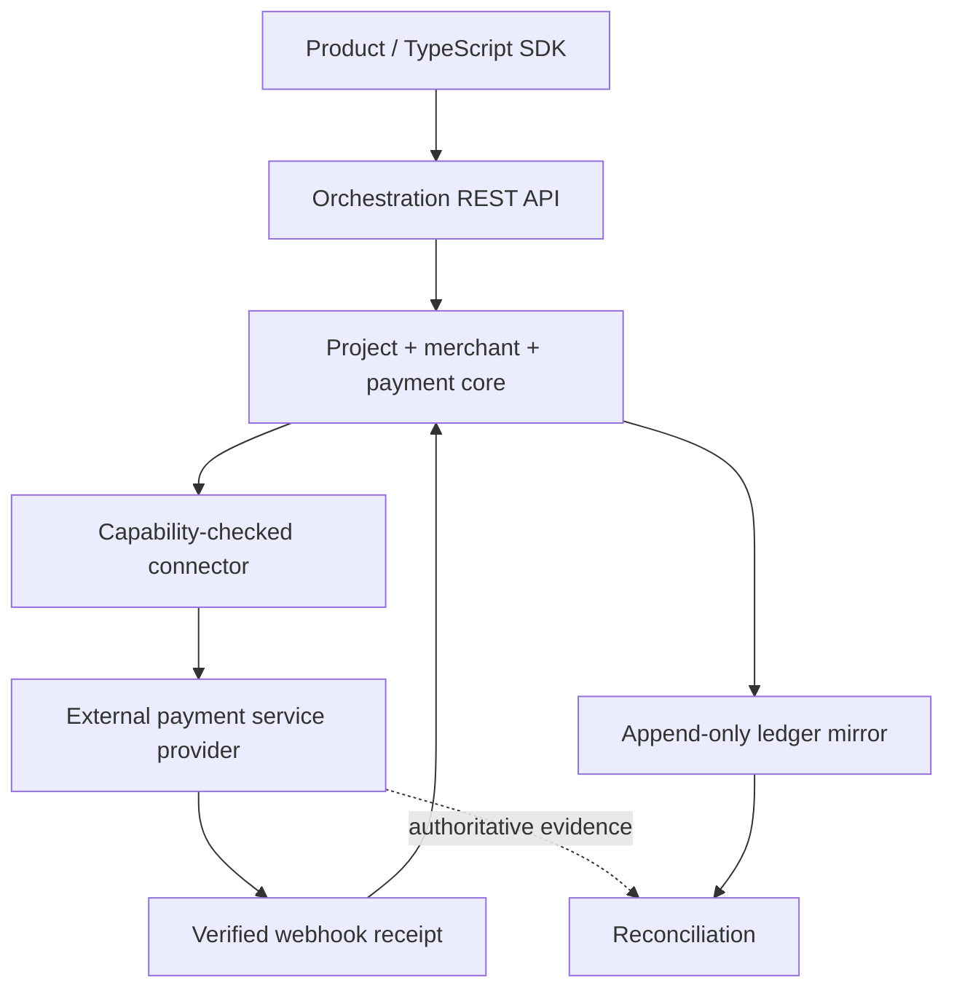

<!-- appfactory:hero:start -->
<div align="center">

# Trigenys Payment Orchestrator

### One payment contract. No double charges by design.

**Provider-neutral payment orchestration for African payment rails, designed around explicit PSP capabilities, replay-safe events and auditable reconciliation — not custody of funds.**

[](#what-is-implemented-and-what-is-not)
[](#transaction-trust-boundary)
[](#target)
[](#what-is-implemented-and-what-is-not)

[**Why**](#why-payment-orchestration) · [**Trust boundary**](#transaction-trust-boundary) · [**Maturity**](#what-is-implemented-and-what-is-not) · [**Production gates**](#proof-before-production) · [**API model**](#target) · [**Runtime**](#runtime) · [**Status**](#public-status)

</div>

---
<!-- appfactory:hero:end -->

## Why payment orchestration

**A payment API should make double processing less likely, not hide who moved the money.** Payment Orchestrator provides one contract for Trigenys applications while keeping country-, currency-, account- and environment-specific PSP behavior behind explicit adapters.

The service is a **prototype / foundation**. It is not a live payment institution, hosted wallet or promise that any provider feature is commercially enabled.

## Transaction trust boundary



- **Idempotency:** a retried request should converge to one logical financial operation; conflicting payloads must not silently reuse a key.
- **Webhooks:** normalize only after provider-specific authentication/signature verification and deduplicate provider event identities.
- **Money:** use integer minor units plus explicit currency, not floating-point ledger amounts.
- **Reconciliation:** compare internal status, fees and settlement against PSP evidence, retaining discrepancies instead of silently overwriting history.
- **Custody:** the PSP collects and settles funds. The local ledger is an accounting mirror, not a spendable balance.

These are engineering contracts and validation targets, not a claim of security certification or live transactional guarantees. See [provider contract](docs/provider-contract.md), [ledger rules](docs/ledger-reconciliation.md) and [threat model](docs/security/threat-model.md).

## What is implemented and what is not

| Area | Evidence | Status |
| --- | --- | --- |
| Provider-neutral domain and capability checks | [Provider contract](docs/provider-contract.md) | Core/contract implemented |
| Append-only ledger and reconciliation rules | [Ledger model](docs/ledger-reconciliation.md) | Prototype semantics, in-memory adapter |
| Payment transitions | [State machine](docs/payment-state-machine.md) | Defined/tested contract |
| Fapshi environments and connector | [Fapshi guide](docs/engineering/fapshi-environments.md) | Explicit sandbox/live configuration; not a live support guarantee |
| Other commercial PSPs and settlement production | [Provider assessments](docs/ecosystem-audit.md) | Feasibility/validation required |

## Proof before production

A live provider must demonstrate signed webhooks, environment-specific capability evidence, replay-safe durable writes, tenant isolation, provider-led settlement reconciliation and review of relevant financial/regulatory obligations. Until then, **no PSP is advertised as production-supported**.

## Target

```text
Zamari / other Trigenys products
        |
        +-- TypeScript SDK
        |       |
        +-------+----> REST API v1
                       |
                       v
                Orchestration core
                - projects
                - merchants
                - payments
                - idempotency
                - webhooks
                - ledger mirror
                - reconciliation
                       |
             +---------+---------+
             |         |         |
        Flutterwave  CinetPay  Notch Pay ...
```

The PSP remains responsible for actual payment collection and settlement. This service must not become a pooled-funds wallet or custodian by accident.

## Core identities

- **Project** — the consuming application, e.g. Zamari.
- **Merchant** — the economic beneficiary, e.g. a training centre.
- **ProviderAccount** — that merchant's external identity at a PSP.
- **Payment** — Trigenys' provider-neutral payment intent/state.
- **LedgerEntry** — immutable accounting/reconciliation evidence, not a spendable balance.

## V1

- capability-driven provider contract;
- normalized payments and merchant accounts;
- idempotent write operations;
- signed webhook ingestion;
- Flutterwave marketplace POC;
- CinetPay White Label capability validation;
- ledger/reconciliation primitives;
- REST API v1;
- TypeScript SDK;
- Zamari as first real consumer.

See [RAIDER audit](docs/RAIDER-AUDIT.md), [provider capability contract](docs/provider-contract.md), [payment state machine](docs/payment-state-machine.md), [security threat model](docs/security/threat-model.md), [Flutterwave Cameroon feasibility](docs/providers/flutterwave-cameroon.md), [CinetPay Cameroon / White Label feasibility](docs/providers/cinetpay-cameroon.md), [Notch Pay Sync capability audit](docs/providers/notchpay-sync.md) and [ecosystem audit](docs/ecosystem-audit.md).

See [TypeScript SDK contract](docs/sdk-typescript.md).\n\n## Runtime

Fapshi uses one connector and processing pipeline with separate configured
[sandbox/live environments](docs/engineering/fapshi-environments.md).

The AppFactory foundation currently uses:

- Node.js 24;
- TypeScript;
- native Node HTTP bootstrap;
- Node test runner;
- AppFactory Project Automation.

Hosting, database and queue are intentionally not selected yet. They will follow measured workload and security requirements instead of being hard-coded by the generator.

## Development

```bash
npm install
npm run check
npm run dev
```

Current endpoint:

- `GET /health`

## Public status

The repository is public for development visibility. **No open-source license has been selected yet**, so public visibility must not be interpreted as permission to redistribute the code.

## Engineering standard

This repository follows Trigenys RAIDER. Read `AGENTS.md` and `docs/engineering/lessons-learned.md` before risky changes.
